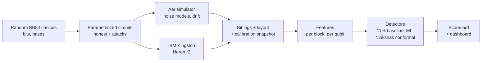

<div align="center">

# Essential Engineers: Nirikshak

**VTU-QFF-HC-0173** &nbsp;|&nbsp; Tier: **Both**

**Nirikshak** ("inspector"): catching real eavesdroppers on real quantum hardware.
A hardware-in-the-loop stress test and drift-robust eavesdropper detector for BB84
Quantum Key Distribution (QKD), built with Qiskit and run on IBM Quantum hardware.

</div>

---

<div align="center">

| | |
| :--- | :--- |
| **Project** | Nirikshak |
| **Team** | Essential Engineers |
| **Team ID** | VTU-QFF-HC-0173 |
| **Tier** | Both |
| **Track** | Track 1: Quantum Cryptography & Security |
| **Repository** | [vtu-hc-essential-engineers](https://github.com/vtu-qiskit-fall-fest-2026/vtu-hc-essential-engineers.git) |
| **Organisation** | [vtu-qiskit-fall-fest-2026](https://github.com/vtu-qiskit-fall-fest-2026) |
| **Event** | VTU-QFF Hackathon, VTU-Qiskit Fall Fest 2026 |

</div>

---

## Table of Contents

- [Team Members](#team-members-github-ids)
- [Problem Statement](#problem-statement)
- [Proposed Solution](#proposed-solution)
- [Approach & Architecture](#approach--architecture)
- [Tech Stack](#tech-stack)
- [Project Structure](#project-structure)
- [How to Run](#how-to-run)
- [How to Push Code](#how-to-push-code)
- [Results](#results)
- [Hardware Budget](#hardware-budget)
- [Submission Checklist](#submission-checklist)
- [Resources](#resources)
- [License](#license)

---

## Team Members (GitHub IDs)

| # | Name | GitHub Username | Role |
| :-- | :--- | :--- | :--- |
| 1 | J Bhuvanesh | [@Bhuvan-esh](https://github.com/Bhuvan-esh) | Team Lead |
| 2 | Dipankar Chettri | [@dipankarchettri](https://github.com/dipankarchettri) | Developer |
| 3 | Anusha A | [@anusha1234-dot](https://github.com/anusha1234-dot) | Developer |

---

## Problem Statement

**Problem:** Eavesdropper detectors for QKD are trained and tested almost entirely in
simulation. Nobody has measured whether they can tell normal hardware drift from a real
attack on real quantum hardware, so deployed QKD links risk false alarms that discard
valid keys, or eavesdroppers who go undetected.

**Why it matters:**

- BB84 detects an eavesdropper through the quantum bit error rate (QBER). The textbook
  alarm fires above about 11%, but a partial attack (for example 10% of rounds
  intercepted) adds only about 2.5% and stays below it.
- Real devices drift with temperature, aging and recalibration. Recent work shows
  simulation-trained QKD detectors degrade sharply under shifted conditions and names
  hardware-generated logs as future work (arXiv 2610.25203, arXiv 2605.27497).
- India's QKD deployment is accelerating: a 1,000 km National Quantum Mission network,
  C-DOT QKD products, and DRDO field and live-network trials. European security agencies
  (ANSSI, BSI, NLNCSA, Swedish NCSA) state QKD is not yet mature from a security
  perspective.

**Track / Category:** Both (hybrid) · Track 1 · Quantum Cryptography & Security

---

## Proposed Solution

**Solution:** We run honest BB84 sessions and qubit-level attacks on IBM Quantum hardware,
stress-test widely used eavesdropper detectors that were trained in simulation against
that hardware data, and build a detector that stays calibrated under device drift. The
outputs are an open dataset of hardware BB84 attack logs, a reusable scorecard, and a
live dashboard.

**Key idea:** Measure today's honest noise with interleaved reference rounds and set the
alarm threshold by split-conformal calibration, so the false-alarm rate is stated in
advance and small attacks are flagged even when they stay under the 11% textbook limit.

**Why this works:**

1. **Real attacks on real qubits.** Full and partial intercept-resend (mid-circuit
   measurement) and an entangling-probe attack run as real qubit operations, repeated
   across qubits and time to capture real noise and drift.
2. **Simulation-to-hardware stress test.** The QBER threshold, Random Forest and XGBoost
   on temporal features, and a small quantum classifier are trained on simulator data and
   evaluated on hardware data. We report the miss rate at a fixed false-alarm budget,
   normal and worst case.
3. **Drift-robust detector.** Honest reference rounds plus per-qubit features separate
   device drift from eavesdropping without trusting the reported calibration alone.
4. **Honest scope.** Optical-only attacks (photon-number splitting, detector blinding) are
   simulated and labelled as such, since IBM's superconducting qubits are not photons.

---

## Approach & Architecture



1. **Input:** random bits and bases for Alice, Bob and Eve, many rounds per circuit
   (one round per qubit), swept as Sampler V2 parameter bindings so one compiled circuit
   covers many random choices.
2. **Quantum core:** BB84 prepare-and-measure circuits with attacks inserted between
   preparation and measurement: intercept-resend (Eve measures in a random basis
   mid-circuit) and an entangling probe (controlled rotation onto Eve's ancilla).
3. **Execution:** the same Sampler V2 interface on Aer (local) and on IBM hardware (job
   mode). Qubits are picked from live calibration, spread out to limit crosstalk; each
   job stores the physical layout and a calibration snapshot.
4. **Post-processing:** sifting, QBER per basis, basis asymmetry, per-qubit error rates.
5. **Output:** alarms from each detector, scored as false-alarm rate and miss rate, shown
   in a Streamlit dashboard.

---

## Tech Stack

| Layer | Technology |
| :--- | :--- |
| Language | Python 3.11+ (developed on 3.12) |
| Quantum SDK | Qiskit 2.6.0, Qiskit IBM Runtime 0.50.0 (Sampler V2, job mode) |
| Simulation | Qiskit Aer 0.18.0 (matrix product state), `FakeKingston` noise |
| Hardware | IBM Quantum Open Plan, `ibm_kingston` (Heron r2) |
| ML | scikit-learn 1.9.1, XGBoost 3.4.1, optional qiskit-machine-learning |
| Detectors | 11% QBER threshold, split-conformal threshold |
| Frontend | Streamlit 1.66.0 |
| Testing | pytest |
| Version control | Git + GitHub |

---

## Project Structure

```text
vtu-hc-essential-engineers/
├── README.md
├── LICENSE
├── pyproject.toml           # package metadata and dependencies
├── requirements.txt         # pinned direct dependencies (pip install -r)
├── requirements.lock        # full tested environment (Linux, Python 3.12)
├── .env.example             # IBM credential template (copy to .env)
├── nirikshak/
│   ├── protocol/            # BB84 parameterized templates, sifting, QBER
│   ├── attacks/             # intercept-resend (full/partial), entangling probe
│   ├── noise/               # noise models, benign drift schedules
│   ├── features/            # per-block and per-qubit features
│   ├── detectors/           # 11% QBER baseline, split-conformal threshold
│   ├── scorecard/           # false-alarm and miss rates
│   ├── hardware/            # credentials, qubit selection, calibration, Sampler jobs
│   ├── sim.py               # Aer runner (same Sampler V2 interface as hardware)
│   └── dashboard.py         # dashboard launcher (python -m nirikshak.dashboard)
├── app/dashboard.py         # Streamlit dashboard (simulator mode)
├── scripts/
│   ├── check_ibm.py         # account check (free, submits no jobs)
│   └── hw_smoke.py          # small hardware test (dry run free; --submit uses quantum time)
├── tests/                   # pytest suite
├── data/                    # raw/ and hardware/ outputs (git-ignored)
├── notebooks/               # experiments and figures
└── PROJECT.md               # full design document
```

---

## How to Run

### Prerequisites

- Python 3.11 or newer
- Git
- Optional, for hardware runs: a free IBM Quantum account

### 1. Clone the repository

```bash
git clone https://github.com/vtu-qiskit-fall-fest-2026/vtu-hc-essential-engineers.git
cd vtu-hc-essential-engineers
```

### 2. Create a virtual environment and install

```bash
python3 -m venv .venv
source .venv/bin/activate        # Linux / macOS
# .venv\Scripts\activate         # Windows (PowerShell)

pip install --upgrade pip
pip install -r requirements.txt
```

`requirements.txt` pins the direct dependencies and installs this package. The exact
environment we tested (Linux, Python 3.12) is in `requirements.lock`.

**Linux note:** qiskit-aer and scikit-learn each bundle their own `libgomp`, and loaded
together they can fail with `cannot allocate memory in static TLS block`. `import nirikshak`
handles this automatically by restarting the command once with
`GLIBC_TUNABLES=glibc.rtld.optional_static_tls=4096` set (see `nirikshak/_runtime.py`).
In Jupyter, set that variable before starting the notebook server instead.

### 3. Run the tests and the dashboard

```bash
python -m pytest -q
python -m nirikshak.dashboard      # opens the Streamlit dashboard
```

### 4. Optional: IBM Quantum hardware

Put your own API key in `.env` (git-ignored; never commit or share it):

```bash
cp .env.example .env
# edit .env and set IBM_QUANTUM_TOKEN=<your-api-key>
```

If `IBM_QUANTUM_TOKEN` is empty, the code falls back to an account saved with
`QiskitRuntimeService.save_account()`. Then:

```bash
python scripts/check_ibm.py          # free: lists backends, submits no jobs
python scripts/hw_smoke.py           # free: dry run on FakeKingston noise
python scripts/hw_smoke.py --submit  # real job, about 3 s of quantum time
```

---

## How to Push Code

> Full walkthrough: **[Git & Collaboration Handbook](../vtu-hc-guide-git-and-collaboration)**.
> Only the final commit on `main` at the deadline is judged.

### Configure Git (first time only, in this repository)

```bash
git config user.name  "Your Name"
git config user.email "you@example.com"
```

### Everyday workflow

```bash
# 1. Get the latest changes
git checkout main
git pull origin main

# 2. Create a branch for your work
git checkout -b feature/my-task

# 3. Commit your work
git add .
git commit -m "feat: describe the change"

# 4. Push the branch
git push -u origin feature/my-task

# 5. Open a Pull Request on GitHub and request a review
#    https://github.com/vtu-qiskit-fall-fest-2026/vtu-hc-essential-engineers/compare/main...feature/my-task

# 6. After approval, merge into main
git checkout main
git pull origin main
git branch -d feature/my-task
```

### Commit message convention

| Prefix | Meaning |
| :--- | :--- |
| `feat:` | New feature |
| `fix:` | Bug fix |
| `docs:` | Documentation only |
| `test:` | Adding or fixing tests |
| `refactor:` | Code restructure, no behaviour change |
| `chore:` | Build/config/dependency changes |

### Collaborating on the same repo

- **Never push directly to `main`**: open a Pull Request.
- **Pull before you push** to avoid rejected commits.
- **Never commit `.env`** or any API key.
- **Ask for a review** before merging.

---

## Results

> Preliminary. Each number states the backend that produced it. Detector scorecards
> (miss rate at a fixed false-alarm budget) will be added as the full dataset is collected.

**Smoke test, 21 Oct 2026:** 16 rounds per shot, 25 random bindings, 64 shots per
binding, honest and 50% intercept-resend in one job.

| Measurement | Backend | Qubits | QBER | Notes |
| :--- | :--- | :--- | :-: | :--- |
| Honest | `ibm_kingston` (job `dbcalg9gv2cc73e9unp0`) | 0-15 (default layout) | 5.27% | One qubit had 44% error |
| Honest, bad qubit excluded | `ibm_kingston` | 15 of 0-15 | 1.92% | |
| 50% intercept-resend, attacked rounds | `ibm_kingston` | 0-15 | 29.4% | Theory: about 25% plus noise |
| 50% intercept-resend, unattacked rounds | `ibm_kingston` | 0-15 | 3.35% | |
| Honest | Aer + `FakeKingston` noise | 0-15 | 4.45% | |
| Honest | Aer + `FakeKingston` noise | calibration-picked, spread | 0.97% | |
| Quantum time used | `ibm_kingston` | | 3 s | IBM quick estimate: 3.1 s |

**Classical baseline:** the textbook 11% QBER threshold. A 10% partial intercept
on a 1-2% honest noise floor gives about 3.5-4.5% QBER, which this baseline does not flag.

```text
$ python -m pytest -q
12 passed
```

---

## Hardware Budget

The IBM Quantum Open Plan gives 10 minutes (600 s) of quantum time per rolling 28-day
window per account; check yours with `get_service().usage()`. Session mode is not
available; use job or batch mode. At most 3 jobs can be queued or running at once.
IBM's quick usage estimate is `2 + 0.00035 x executions` seconds per job. Test every
circuit on the simulator first, and combine circuits into few large jobs.

---

## Submission Checklist

- [ ] Repository created and **public**
- [ ] All team members added as **collaborators** and invitations accepted
- [x] Team members listed in this README with their GitHub usernames
- [x] Problem statement and proposed solution clearly described
- [x] Quantum approach explained (with a diagram)
- [ ] `requirements.txt` committed with pinned versions
- [ ] `git clone` → `pip install` → run works on a clean machine
- [ ] Results table included, with a classical baseline (preliminary table above)
- [x] Tests included and passing (`pytest -q`)
- [ ] Notebooks committed with outputs cleared
- [ ] Demo video or live demo slot confirmed
- [x] `LICENSE` file added
- [ ] Latest changes merged into `main`

---

## Resources

| Resource | Link |
| :--- | :--- |
| Git & collaboration handbook | [Git & Collaboration Handbook](../vtu-hc-guide-git-and-collaboration) |
| Problem statements, solutions & terms | [Problem Statements, Solutions & Terms](../vtu-hc-guide-problem-and-solution) |
| README writing guide | [README Guide & Template](../vtu-hc-guide-readme-template) |
| Qiskit documentation | https://docs.quantum.ibm.com/ |
| Qiskit Runtime & primitives | https://quantum.cloud.ibm.com/docs/ |
| Qiskit Aer simulator | https://docs.quantum.ibm.com/guides/simulator |
| IBM Quantum Platform | https://quantum.cloud.ibm.com/ |
| Full design document | [PROJECT.md](PROJECT.md) |

---

## License

Released under the [MIT License](LICENSE). See `LICENSE` for details.

---

<div align="center">

**Essential Engineers** · Team ID `VTU-QFF-HC-0173` · Tier `Both`
· Built with Qiskit for the VTU-QFF Hackathon

[Back to Top](#essential-engineers-nirikshak)

</div>
