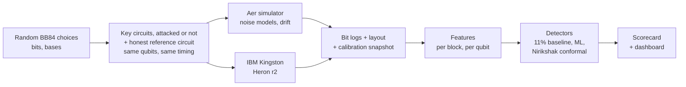
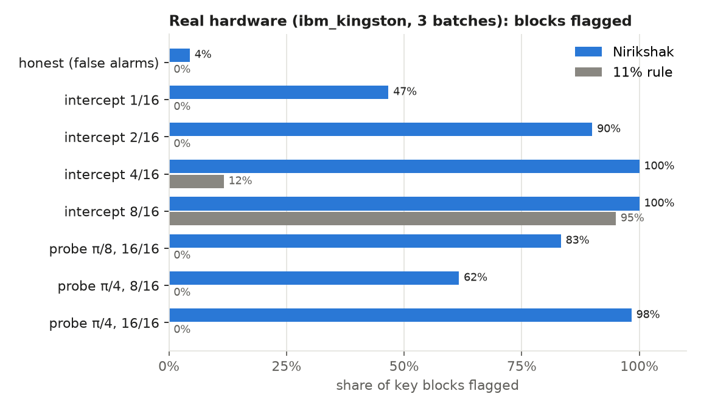
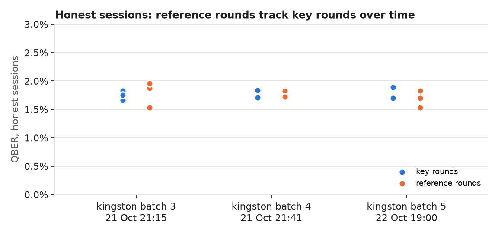
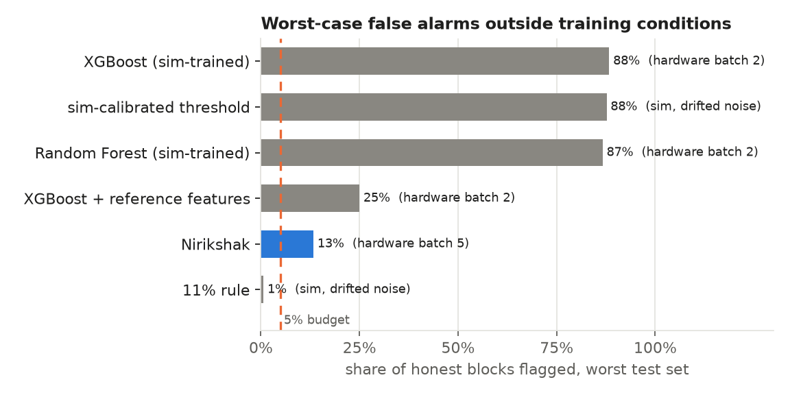

<div align="center">

# Essential Engineers: Nirikshak

**VTU-QFF-HC-0173** &nbsp;|&nbsp; Tier: **Both**

**Nirikshak** ("inspector"): catching real eavesdroppers on real quantum hardware.
A hardware-in-the-loop stress test and drift-robust eavesdropper detector for BB84
Quantum Key Distribution (QKD), built with Qiskit and run on IBM Quantum hardware.

**Result on `ibm_kingston`:** across three batches 22 hours apart, Nirikshak flagged all 21
attacked sessions (p ≤ 0.0002), including an eavesdropper touching 1 of 16 rounds, and none of
the 9 honest ones. The textbook 11% rule caught only the largest attack, and BB84 would have kept
producing keys through the rest. On two more machines it caught every attack with no retuning:
7 of 7 on the noisier `ibm_marrakesh` (honest QBER 3.6%), where detectors trained in simulation
flagged 78-83% of honest blocks, and 7 of 7 on `ibm_fez` (2.0%). Across all three machines:
35 of 35 attacked sessions flagged, 0 of 15 honest ones. Trained detectors flagged up to 88% of
honest blocks once noise shifted.

</div>

---

<div align="center">

| | |
| :--- | :--- |
| **Project** | Nirikshak |
| **Team** | Essential Engineers |
| **Team ID** | VTU-QFF-HC-0173 |
| **Tier** | Both |
| **Track** | Track 1: Quantum Cryptography & Security |
| **Repository** | [vtu-hc-essential-engineers](https://github.com/vtu-qiskit-fall-fest-2026/vtu-hc-essential-engineers.git) |
| **Organisation** | [vtu-qiskit-fall-fest-2026](https://github.com/vtu-qiskit-fall-fest-2026) |
| **Event** | VTU-QFF Hackathon, VTU-Qiskit Fall Fest 2026 |
| **Demo video** | [youtu.be/gO9v1e-yHNs](https://youtu.be/gO9v1e-yHNs) (4:46) |
| **Live app** | [vtu-qiskit-fall-fest-2026.github.io/vtu-hc-essential-engineers](https://vtu-qiskit-fall-fest-2026.github.io/vtu-hc-essential-engineers/) |

</div>

---

## Table of Contents

- [Team Members](#team-members-github-ids)
- [Problem Statement](#problem-statement)
- [Proposed Solution](#proposed-solution)
- [Approach & Architecture](#approach--architecture)
- [Tech Stack](#tech-stack)
- [Project Structure](#project-structure)
- [How to Run](#how-to-run)
- [How to Push Code](#how-to-push-code)
- [Results](#results)
- [Reproduce the Results](#reproduce-the-results)
- [Hardware Budget](#hardware-budget)
- [Submission Checklist](#submission-checklist)
- [Resources](#resources)
- [License](#license)

---

## Team Members (GitHub IDs)

| # | Name | GitHub Username | Role |
| :-- | :--- | :--- | :--- |
| 1 | J Bhuvanesh | [@Bhuvan-esh](https://github.com/Bhuvan-esh) | Team Lead |
| 2 | Dipankar Chettri | [@dipankarchettri](https://github.com/dipankarchettri) | Developer |
| 3 | Anusha A | [@anusha1234-dot](https://github.com/anusha1234-dot) | Developer |

---

## Problem Statement

**Problem:** Eavesdropper detectors for QKD are trained and tested almost entirely in
simulation. Nobody has measured whether they can tell normal hardware drift from a real
attack on real quantum hardware, so deployed QKD links risk false alarms that discard
valid keys, or eavesdroppers who go undetected.

**Why it matters:**

- BB84 reveals an eavesdropper through the quantum bit error rate (QBER). The 11% figure
  is the security proof's limit for distilling any secret key (Shor-Preskill), not an
  attack detector: a partial attack (for example 10% of rounds intercepted) adds only about
  2.5% and stays far below it. Privacy amplification can still protect an ideal key, but the
  operator never learns the link is being tapped, cannot locate it, and cannot tell an attack
  from drift. Nirikshak is the missing intrusion-detection layer.
- Real devices drift with temperature, aging and recalibration. Recent work shows
  simulation-trained QKD detectors degrade sharply under shifted conditions and names
  hardware-generated logs as future work (arXiv 2610.25203, arXiv 2605.27497).
- India's QKD deployment is accelerating: a 1,000 km National Quantum Mission network,
  C-DOT QKD products, and DRDO field and live-network trials. European security agencies
  (ANSSI, BSI, NLNCSA, Swedish NCSA) state QKD is not yet mature from a security
  perspective.

**Track / Category:** Both (hybrid) · Track 1 · Quantum Cryptography & Security

---

## Proposed Solution

**Solution:** We run honest BB84 sessions and qubit-level attacks on IBM Quantum hardware,
stress-test widely used eavesdropper detectors that were trained in simulation against
that hardware data, and build a detector that stays calibrated under device drift. The
outputs are an open dataset of hardware BB84 attack logs, a reusable scorecard, and a
live dashboard.

**Key idea:** In every run, a separate honest calibration circuit on the same qubits (no
channel, so Eve cannot touch it) measures today's noise. The alarm threshold is set from it
by split-conformal calibration, so the false-alarm rate is stated in advance in every session,
drift or not, and small attacks are flagged far below the 11% limit. Per session, a permutation test of key
blocks against reference blocks gives one verdict (attack or clean) with a p-value.

**Why this works:**

1. **Real attacks on real qubits.** Full and partial intercept-resend (mid-circuit
   measurement) and an entangling-probe attack run as real qubit operations, repeated
   across qubits and time to capture real noise and drift.
2. **Simulation-to-hardware stress test.** A sim-calibrated QBER threshold, Random Forest
   and XGBoost are trained on simulator data (alarm threshold set for 5% false alarms) and
   tested on drifted simulation, a Kingston noise snapshot and real hardware data.
3. **Drift-robust detector.** Each session's reference blocks set that session's threshold,
   so no simulator and no stale calibration is trusted.
4. **Fair hardware emulation.** All circuits in a batch share the same timing between
   preparation and measurement, and idle qubits get a spin echo, so the only difference
   between honest and attacked circuits is Eve herself (see Results).
5. **Honest scope.** Optical-only attacks (photon-number splitting, detector blinding) are
   simulated and labelled as such, since IBM's superconducting qubits are not photons.

---

## Approach & Architecture



1. **Input:** random bits and bases for Alice, Bob and Eve, many rounds per circuit
   (one round per qubit), swept as Sampler V2 parameter bindings so one compiled circuit
   covers many random choices.
2. **Quantum core:** BB84 prepare-and-measure circuits with attacks inserted between
   preparation and measurement: intercept-resend (Eve measures in a random basis
   mid-circuit) and an entangling probe (controlled rotation onto Eve's ancilla).
3. **Execution:** the same Sampler V2 interface on Aer (local) and on IBM hardware (job
   mode). One job holds a whole batch: 10 sessions, each a key and a reference circuit.
   Qubits are picked from live calibration, spread out to limit crosstalk; every circuit
   gets the same slot duration with a spin echo on idle qubits; each job stores the layout
   and a calibration snapshot.
4. **Post-processing:** sifting, QBER per basis, basis asymmetry, per-qubit error rates.
5. **Output:** per-session verdicts and p-values, per-block alarms, BB84 key rates, scored as
   false-alarm and detection rates with 95% intervals, shown in a Streamlit dashboard.

---

## Tech Stack

| Layer | Technology |
| :--- | :--- |
| Language | Python 3.11+ (developed on 3.12) |
| Quantum SDK | Qiskit 2.6.0, Qiskit IBM Runtime 0.50.0 (Sampler V2, job mode) |
| Simulation | Qiskit Aer 0.18.0 (matrix product state), `FakeKingston` noise |
| Hardware | IBM Quantum Open Plan, `ibm_kingston`, `ibm_marrakesh` and `ibm_fez` (Heron r2) |
| ML | scikit-learn 1.9.1, XGBoost 3.4.1 |
| Detectors | 11% QBER rule, sim-calibrated threshold, Random Forest, XGBoost, Nirikshak (per-session conformal) |
| Statistics | Split-conformal thresholds, permutation test (session verdict), Clopper-Pearson intervals (SciPy) |
| Frontend | React 19 + TypeScript (Vite), hand-built SVG charts, GitHub Pages; Streamlit 1.66.0 analysis dashboard; matplotlib for README figures |
| Testing | pytest, GitHub Actions (`.github/workflows/tests.yml`) |
| Version control | Git + GitHub |

---

## Project Structure

```text
vtu-hc-essential-engineers/
├── README.md
├── LICENSE
├── pyproject.toml           # package metadata and dependencies
├── requirements.txt         # pinned direct dependencies (pip install -r)
├── requirements.lock        # full tested environment (Linux, Python 3.12)
├── .env.example             # IBM credential template (copy to .env)
├── .github/workflows/       # CI: pytest on every push
├── src/main.py              # end-to-end entry point (python -m src.main)
├── nirikshak/
│   ├── protocol/            # BB84 parameterized templates, sifting, QBER
│   ├── attacks/             # intercept-resend (full/partial), entangling probe
│   ├── noise/               # noise models, benign drift schedules
│   ├── features/            # per-block and per-qubit features
│   ├── detectors/           # 11% rule, conformal thresholds, Nirikshak, sim-trained ML
│   ├── scorecard/           # false-alarm and detection rates per condition
│   ├── hardware/            # credentials, qubit selection, calibration, timing match, batches
│   ├── monitor/             # streaming monitor: telemetry format, per-link verdicts, demo network
│   ├── session.py           # key + reference rounds per session
│   ├── conditions.py        # standard attack conditions (simulation and hardware)
│   ├── sim.py               # Aer runner (same Sampler V2 interface as hardware)
│   └── dashboard.py         # dashboard launcher (python -m nirikshak.dashboard)
├── web/                     # React frontend (results bundled from web/src/results/)
├── app/dashboard.py         # Streamlit analysis dashboard
├── scripts/
│   ├── check_ibm.py         # account check (free, submits no jobs)
│   ├── hw_smoke.py          # small hardware test (dry run free; --submit uses quantum time)
│   ├── make_sim_dataset.py  # simulated block dataset (train, drift, kingston regimes)
│   ├── collect.py           # hardware batch: plan, --submit, --fetch
│   ├── stress_test.py       # sim-trained detectors vs Nirikshak on all test sets
│   ├── scorecard.py         # session verdicts, key rates, 95% intervals
│   ├── figures.py           # README figures (results/figures/)
│   ├── export_web.py        # results as JSON for the web frontend
│   └── hardware_lessons.py  # per-batch honest / touched / untouched QBER from raw bits
├── results/                 # scorecard, stress test, sessions.csv, hardware_lessons.csv, figures/
├── tests/                   # pytest suite
├── data/hardware/           # hardware block datasets (one parquet per job)
├── data/sim/                # simulated block datasets (train, test, drift, kingston, honest-only)
├── data/raw/                # raw bits and job metadata (git-ignored)
├── notebooks/walkthrough.ipynb  # guided tour on the committed data (outputs cleared)
└── PROJECT.md               # full design document
```

---

## How to Run

### Prerequisites

- Python 3.11 or newer
- Git
- Optional, for hardware runs: a free IBM Quantum account

### 1. Clone the repository

```bash
git clone https://github.com/vtu-qiskit-fall-fest-2026/vtu-hc-essential-engineers.git
cd vtu-hc-essential-engineers
```

### 2. Create a virtual environment and install

```bash
python3 -m venv .venv
source .venv/bin/activate        # Linux / macOS
# .venv\Scripts\activate         # Windows (PowerShell)

pip install --upgrade pip
pip install -r requirements.txt
```

`requirements.txt` pins the direct dependencies and installs this package. The exact
environment we tested (Linux, Python 3.12) is in `requirements.lock`.

**Linux note:** qiskit-aer and scikit-learn each bundle their own `libgomp`, and loaded
together they can fail with `cannot allocate memory in static TLS block`. `import nirikshak`
handles this automatically by restarting the command once with
`GLIBC_TUNABLES=glibc.rtld.optional_static_tls=4096` set (see `nirikshak/_runtime.py`).
In Jupyter, set that variable before starting the notebook server instead:

```bash
pip install jupyterlab
GLIBC_TUNABLES=glibc.rtld.optional_static_tls=4096 jupyter lab notebooks/walkthrough.ipynb
```

### 3. Run it

```bash
python -m src.main --demo         # 1 minute: honest vs attacked session on the simulator
python -m src.main                # demo + stress test + scorecard + figures, a few minutes
python -m pytest -q               # tests
python -m nirikshak.dashboard     # Streamlit analysis dashboard
python -m nirikshak.monitor --demo demo.jsonl && python -m nirikshak.monitor demo.jsonl  # network monitor
```

No IBM account is needed: the hardware results are committed in `data/hardware/`.

### 4. The web app

```bash
cd web
npm install
npm run dev                       # http://localhost:5173
```

Pages: hardware results, network monitor (replays a day of link verdicts), stress test, and how it
works with a simulator. Needs Node 20 or newer. The data comes from `python scripts/export_web.py`
(run by `python -m src.main`; add `--sim` to regenerate the simulator grid). On every push to
`main` that touches `web/`, `.github/workflows/pages.yml` publishes it to GitHub Pages:
<https://vtu-qiskit-fall-fest-2026.github.io/vtu-hc-essential-engineers/>.

### 5. Optional: IBM Quantum hardware

Put your own API key in `.env` (git-ignored; never commit or share it):

```bash
cp .env.example .env
# edit .env and set IBM_QUANTUM_TOKEN=<your-api-key>
```

If `IBM_QUANTUM_TOKEN` is empty, the code falls back to an account saved with
`QiskitRuntimeService.save_account()`. Then:

```bash
python scripts/check_ibm.py          # free: lists backends, submits no jobs
python scripts/hw_smoke.py           # free: dry run on FakeKingston noise
python scripts/hw_smoke.py --submit  # real job, about 3 s of quantum time
```

---

## How to Push Code

> Full walkthrough: **[Git & Collaboration Handbook](../vtu-hc-guide-git-and-collaboration)**.
> Only the final commit on `main` at the deadline is judged.

### Configure Git (first time only, in this repository)

```bash
git config user.name  "Your Name"
git config user.email "you@example.com"
```

### Everyday workflow

```bash
# 1. Get the latest changes
git checkout main
git pull origin main

# 2. Create a branch for your work
git checkout -b feature/my-task

# 3. Commit your work
git add .
git commit -m "feat: describe the change"

# 4. Push the branch
git push -u origin feature/my-task

# 5. Open a Pull Request on GitHub and request a review
#    https://github.com/vtu-qiskit-fall-fest-2026/vtu-hc-essential-engineers/compare/main...feature/my-task

# 6. After approval, merge into main
git checkout main
git pull origin main
git branch -d feature/my-task
```

### Commit message convention

| Prefix | Meaning |
| :--- | :--- |
| `feat:` | New feature |
| `fix:` | Bug fix |
| `docs:` | Documentation only |
| `test:` | Adding or fixing tests |
| `refactor:` | Code restructure, no behaviour change |
| `chore:` | Build/config/dependency changes |

### Collaborating on the same repo

- **Never push directly to `main`**: open a Pull Request.
- **Pull before you push** to avoid rejected commits.
- **Never commit `.env`** or any API key.
- **Ask for a review** before merging.

---

## Results

All numbers state the backend that produced them; brackets are exact 95% intervals
(Clopper-Pearson). False-alarm budget alpha = 5%. Full tables: [`results/scorecard.md`](results/scorecard.md),
[`results/stress_test.md`](results/stress_test.md), per session: [`results/sessions.csv`](results/sessions.csv).

Nirikshak gives two outputs per session (20 key blocks + 20 reference blocks):

- **Session verdict (the decision):** a one-sided permutation test, are the key blocks noisier
  than this session's reference blocks? At most 5% of honest sessions are flagged.
- **Block alarms (where to look):** each key block is compared with a threshold set from the
  session's reference blocks (split-conformal). About 5% of honest blocks on average, more in
  some sessions, since the threshold rests on 20 reference blocks.

### Real hardware: `ibm_kingston`, batches 3-5 (spin echo, 21 Oct 21:15 to 22 Oct 19:00)



| Condition (3 sessions each) | Key QBER | BB84 key rate | Session verdict | Nirikshak, per block | 11% rule, per block |
| :--- | :-: | :-: | :-: | :-: | :-: |
| Honest | 1.7-1.9% | 0.73-0.76 | **0 of 9 flagged** | 4% (2%-9%) | 0% |
| Intercept-resend, 1 of 16 rounds | 3.0-3.2% | 0.59-0.61 | **3 of 3** | 47% (34%-60%) | 0% |
| Intercept-resend, 2 of 16 rounds | 4.8-5.1% | 0.42-0.45 | **3 of 3** | 90% (79%-96%) | 0% |
| Intercept-resend, 4 of 16 rounds | 7.8-8.5% | 0.16-0.21 | **3 of 3** | 100% (94%-100%) | 12% |
| Intercept-resend, 8 of 16 rounds | 14.2-15.4% | 0 (abort) | **3 of 3** | 100% (94%-100%) | 95% |
| Entangling probe (3 settings) | 3.7-5.5% | 0.39-0.55 | **9 of 9** | 62-98% | 0% |

- All 21 attacked sessions: 100% flagged (84%-100%), every p-value ≤ 0.0002. Honest sessions:
  0 of 9 (0%-34%; nine sessions cannot pin the rate down further, see simulation below).
- Key rate is the asymptotic BB84 rate `1 - 2h(QBER)` per sifted bit. For every attack except
  8 of 16 it stays positive: the protocol would keep making keys and never report the
  eavesdropper. That is the gap Nirikshak fills.



Honest QBER stayed at 1.7-1.9% over 22 hours, and in every session the reference rounds sat
within 0.2 points of the key rounds, which is what lets them calibrate the alarm.

### Second machine: `ibm_marrakesh`, batch 7 (job `dbd3bts24mrc73cklb10`, 22 Oct 21:42)

Same circuits, same detector settings, nothing retuned. Marrakesh is twice as noisy (honest QBER
3.5-3.9%, reference rounds 3.4-3.8%), and its two-qubit gates make the entangling probe much more
visible.

| Condition | Key QBER | BB84 key rate | Session verdict | Nirikshak, per block | 11% rule, per block |
| :--- | :-: | :-: | :-: | :-: | :-: |
| Honest (3 sessions) | 3.5-3.9% | 0.52-0.56 | **0 of 3 flagged** | 3% (0%-12%) | 0% |
| Intercept-resend, 1 of 16 rounds | 4.9% | 0.43 | **attack**, p = 0.0035 | 5% | 0% |
| Intercept-resend, 2 of 16 rounds | 7.0% | 0.27 | **attack** | 85% | 0% |
| Intercept-resend, 4 of 16 rounds | 9.5% | 0.10 | **attack** | 100% | 10% |
| Intercept-resend, 8 of 16 rounds | 15.0% | 0 (abort) | **attack** | 100% | 95% |
| Entangling probe (3 settings) | 7.6-11.4% | 0-0.22 | **attack** (3 of 3) | 95-100% | 10-55% |

The 1 of 16 attack shows why the session verdict is the decision: on a noisier machine only 1 of
its 20 blocks crossed the block threshold, but pooling all 20 against the reference blocks still
flagged the session.

### Third machine: `ibm_fez`, batch 6 (job `dbd104pgv2cc738h5m80`, submitted 22 Oct 19:01, ran 23 Oct 01:16)

Same circuits and settings, nothing retuned. Fez's noise floor (honest QBER 1.9-2.2%, reference
rounds 1.8-2.0%) is close to kingston's.

| Condition | Key QBER | BB84 key rate | Session verdict | Nirikshak, per block | 11% rule, per block |
| :--- | :-: | :-: | :-: | :-: | :-: |
| Honest (3 sessions) | 1.9-2.2% | 0.70-0.73 | **0 of 3 flagged** | 8% (3%-18%) | 0% |
| Intercept-resend, 1 of 16 rounds | 3.2% | 0.59 | **attack**, p = 0.0004 | 35% | 0% |
| Intercept-resend, 2 of 16 rounds | 5.2% | 0.41 | **attack** | 95% | 0% |
| Intercept-resend, 4 of 16 rounds | 7.6% | 0.22 | **attack** | 100% | 5% |
| Intercept-resend, 8 of 16 rounds | 13.5% | 0 (abort) | **attack** | 100% | 85% |
| Entangling probe (3 settings) | 4.3-5.7% | 0.37-0.49 | **attack** (3 of 3) | 35-90% | 0% |

Here the noise matches the simulation, so the sim-trained detectors also behave (5-10% honest
blocks flagged); Nirikshak needed no such luck on any of the three machines.

### Simulation: does the session verdict keep its 5% budget?

| Simulated condition | Honest sessions | Flagged |
| :--- | :-: | :-: |
| Training noise | 400 | 5% (3%-8%) |
| Drifted noise | 200 | 6% (4%-11%) |

### Stress test: trained in simulation, tested under shift



Every detector except Nirikshak is trained or calibrated on simulated data
(`data/sim/train.parquet`) for 5% false alarms per block, then tested on drifted simulation, a
Kingston noise snapshot and six hardware batches on three machines.

| Detector | False alarms per block, worst test set | Where |
| :--- | :-: | :--- |
| Sim-calibrated QBER threshold | 88% | drifted simulation |
| Random Forest (sim-trained) | 87% | real hardware, batch 2 |
| XGBoost (sim-trained) | 88% | real hardware, batch 2 |
| XGBoost + reference features | 25% | real hardware, batch 2 |
| **Nirikshak** (block alarms) | **13%** (0-8% on the other sets) | real hardware, batch 5 |

- When hardware noise happens to match the simulation (kingston batches 3-5, 1.7%; `ibm_fez`, 2.0%), the sim-trained
  detectors work and detect slightly more per block than Nirikshak.
- When it does not, they flag most honest blocks: 78-83% on `ibm_marrakesh` (3.6% noise floor),
  82-88% on batch 2 (4%) and in drifted simulation. Nirikshak flags 3% on marrakesh. In the Kingston snapshot they instead miss small attacks (22-28% vs 78%).
- Nirikshak's worst case is batch 5: 8 of 60 honest blocks, spread over 3 sessions whose
  session verdicts were all clean. Reference rounds also help ML: XGBoost with reference
  features drops from 88% to 25% worst-case false alarms.

### What real hardware taught us

| Batch | Timing between preparation and measurement | Honest QBER | Rounds Eve did not touch |
| :--- | :--- | :-: | :-: |
| 1 (`dbcdge9gv2cc73ea4ne0`) | not matched | 0.7% | 2.6-6.4%: they idled during her measurements |
| 2 (`dbcdpek24mrc73cjedeg`) | matched, plain idle | 4.2% (X basis 7%) | 4.4-6.3%: fair, but idling dephases |
| 3 (`dbcdsck24mrc73cjek9g`) | matched, spin echo | 1.7% | 1.6-1.75%: fair and low |
| 4 (`dbce8c0c77vs738641j0`) | matched, spin echo | 1.75% | 1.8-1.9% |
| 5 (`dbd0vo424mrc73cki1l0`) | matched, spin echo, 21 h later | 1.8% | 1.6-2.5% |
| 6, `ibm_fez` (`dbd104pgv2cc738h5m80`) | matched, spin echo | 2.0% | 1.8-2.0% |
| 7, `ibm_marrakesh` (`dbd3bts24mrc73cklb10`) | matched, spin echo | 3.6% | 3.6-4.5% |

Batch 1's detection rates (100% everywhere) were inflated by this artifact and are not
claimed; batches 1-2 are excluded from all pooled hardware numbers. A qubit-0 readout failure
in an earlier smoke test that IBM's calibration did not predict is why qubits are picked from
live calibration and per-qubit errors are recorded.

### Prototype: Nirikshak as a network monitoring layer

`nirikshak.monitor` runs Nirikshak on a stream of link telemetry, one record per block:

```json
{"link_id": "L3", "t": "2026-10-22T14:05:00+05:30", "kind": "key", "sifted": 512, "errors": 9}
```

`kind` is `key` (the key exchange's parameter-estimation sample) or `ref` (local reference
states at the receiver that never cross the channel). Nothing else is needed, no key material and
no vendor-specific fields. Per link and hourly window, the monitor gives a verdict (key vs
reference permutation test, 5% budget), block alarms from a rolling reference window, and an
alarm log. The dashboard's Network monitor tab shows a demo network: four simulated links and
one replaying the real ibm_kingston sessions. Over 30 random seeds (2,100 honest windows):

| Simulated link | Windows flagged | Key blocks flagged per honest window (of 20) |
| :--- | :-: | :-: |
| Honest windows, all links | 5.3% | about 1 (Nirikshak) |
| L2, drifting from 1.7% to 4.2% QBER | 5.0% | 1.0 Nirikshak vs 8.2 for a threshold frozen at commissioning |
| L3, tapped on 1 of 16 rounds | 100% after the tap | 0 for the 11% rule |
| L4, daily cycle + tap on 2 of 16 | 100% after the tap | 0 for the 11% rule |

This is a prototype. The simulated links use binomial error counts, and real deployment
would need photonic details (decoy states, detector statistics, finite-key effects) and
operator integration.

### Limitations

- Three backends: three usable `ibm_kingston` batches over 22 hours, one `ibm_marrakesh` and one
  `ibm_fez` batch, 3 sessions per condition per batch.
  Fifteen honest hardware sessions (all clean) bound the session false-alarm rate only to 0-22%; the 5% claim
  rests on 600 simulated honest sessions.
- Block alarms vary between sessions (up to 15% of one honest hardware session's blocks), because
  each session's threshold comes from 20 reference blocks. The session verdict does not have
  this problem; block intervals treat blocks as independent and are somewhat too narrow.
- 16 rounds per shot, so attacked fractions come in steps of 1/16; shots within a binding share
  random choices (blocks pool 8 bindings).
- Key rates are asymptotic (no finite-key corrections). Optical attacks (photon-number
  splitting, detector blinding) are not run on hardware.

---

## Reproduce the Results

The simulated and hardware datasets are committed, so everything below the hardware step runs
straight away:

```bash
python -m src.main                  # stress test, scorecard, figures (results/)
```

To regenerate the simulated datasets (about 25 minutes):

```bash
python scripts/make_sim_dataset.py                                   # data/sim/
python scripts/make_sim_dataset.py --regimes train --seed 1 --suffix _test
# or all of them: python -m src.main --regenerate
```

Hardware batches (each about 10 s of quantum time; plan is free):

```bash
python scripts/collect.py --batch 7                         # plan only (default backend from .env)
python scripts/collect.py --batch 7 --backend ibm_fez --submit  # submit, returns immediately
python scripts/collect.py --fetch <job_id>                  # download into data/hardware/
python scripts/hardware_lessons.py                          # needs data/raw/ from the collecting machine
```

---

## Hardware Budget

The IBM Quantum Open Plan gives 10 minutes (600 s) of quantum time per rolling 28-day
window per account; check yours with `get_service().usage()`. Session mode is not
available; use job or batch mode. At most 3 jobs can be queued or running at once.
IBM's quick usage estimate is `2 + 0.00035 x executions` seconds per job; a 10-session batch
(25,600 executions) used 10 s. Used so far: 73 s of 600 on one account. Test every
circuit on the simulator first, and combine circuits into few large jobs.

---

## Submission Checklist

- [x] Repository created and **public**
- [ ] All team members added as **collaborators** and invitations accepted
- [x] Team members listed in this README with their GitHub usernames
- [x] Problem statement and proposed solution clearly described
- [x] Quantum approach explained (with a diagram)
- [x] `requirements.txt` committed with pinned versions
- [x] `git clone` → `pip install` → run works on a clean machine
- [x] Results table included, with a classical baseline
- [x] Tests included and passing (`pytest -q`)
- [x] Notebooks committed with outputs cleared (`notebooks/walkthrough.ipynb`)
- [x] Demo video or live demo slot confirmed ([video](https://youtu.be/gO9v1e-yHNs))
- [x] `LICENSE` file added
- [x] Latest changes merged into `main`

---

## Resources

| Resource | Link |
| :--- | :--- |
| Git & collaboration handbook | [Git & Collaboration Handbook](../vtu-hc-guide-git-and-collaboration) |
| Problem statements, solutions & terms | [Problem Statements, Solutions & Terms](../vtu-hc-guide-problem-and-solution) |
| README writing guide | [README Guide & Template](../vtu-hc-guide-readme-template) |
| Qiskit documentation | https://docs.quantum.ibm.com/ |
| Qiskit Runtime & primitives | https://quantum.cloud.ibm.com/docs/ |
| Qiskit Aer simulator | https://docs.quantum.ibm.com/guides/simulator |
| IBM Quantum Platform | https://quantum.cloud.ibm.com/ |
| Full design document | [PROJECT.md](PROJECT.md) |

---

## License

Released under the [MIT License](LICENSE). See `LICENSE` for details.

---

<div align="center">

**Essential Engineers** · Team ID `VTU-QFF-HC-0173` · Tier `Both`
· Built with Qiskit for the VTU-QFF Hackathon

[Back to Top](#essential-engineers-nirikshak)

</div>
