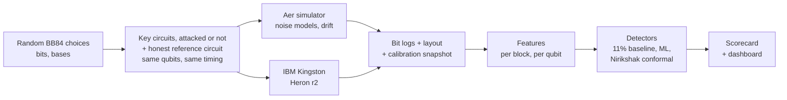

<div align="center">

# Essential Engineers: Nirikshak

**VTU-QFF-HC-0173** &nbsp;|&nbsp; Tier: **Both**

**Nirikshak** ("inspector"): catching real eavesdroppers on real quantum hardware.
A hardware-in-the-loop stress test and drift-robust eavesdropper detector for BB84
Quantum Key Distribution (QKD), built with Qiskit and run on IBM Quantum hardware.

**Result on `ibm_kingston`:** Nirikshak caught an eavesdropper touching 2 of 16 rounds in 95%
of blocks with 0% false alarms, where the textbook 11% rule caught none. Detectors trained in
simulation reached 82-88% false alarms once noise shifted, including on real hardware.

</div>

---

<div align="center">

| | |
| :--- | :--- |
| **Project** | Nirikshak |
| **Team** | Essential Engineers |
| **Team ID** | VTU-QFF-HC-0173 |
| **Tier** | Both |
| **Track** | Track 1: Quantum Cryptography & Security |
| **Repository** | [vtu-hc-essential-engineers](https://github.com/vtu-qiskit-fall-fest-2026/vtu-hc-essential-engineers.git) |
| **Organisation** | [vtu-qiskit-fall-fest-2026](https://github.com/vtu-qiskit-fall-fest-2026) |
| **Event** | VTU-QFF Hackathon, VTU-Qiskit Fall Fest 2026 |

</div>

---

## Table of Contents

- [Team Members](#team-members-github-ids)
- [Problem Statement](#problem-statement)
- [Proposed Solution](#proposed-solution)
- [Approach & Architecture](#approach--architecture)
- [Tech Stack](#tech-stack)
- [Project Structure](#project-structure)
- [How to Run](#how-to-run)
- [How to Push Code](#how-to-push-code)
- [Results](#results)
- [Reproduce the Results](#reproduce-the-results)
- [Hardware Budget](#hardware-budget)
- [Submission Checklist](#submission-checklist)
- [Resources](#resources)
- [License](#license)

---

## Team Members (GitHub IDs)

| # | Name | GitHub Username | Role |
| :-- | :--- | :--- | :--- |
| 1 | J Bhuvanesh | [@Bhuvan-esh](https://github.com/Bhuvan-esh) | Team Lead |
| 2 | Dipankar Chettri | [@dipankarchettri](https://github.com/dipankarchettri) | Developer |
| 3 | Anusha A | [@anusha1234-dot](https://github.com/anusha1234-dot) | Developer |

---

## Problem Statement

**Problem:** Eavesdropper detectors for QKD are trained and tested almost entirely in
simulation. Nobody has measured whether they can tell normal hardware drift from a real
attack on real quantum hardware, so deployed QKD links risk false alarms that discard
valid keys, or eavesdroppers who go undetected.

**Why it matters:**

- BB84 reveals an eavesdropper through the quantum bit error rate (QBER). The 11% figure
  is the security proof's limit for distilling any secret key (Shor-Preskill), not an
  attack detector: a partial attack (for example 10% of rounds intercepted) adds only about
  2.5% and stays far below it. Privacy amplification can still protect an ideal key, but the
  operator never learns the link is being tapped, cannot locate it, and cannot tell an attack
  from drift. Nirikshak is the missing intrusion-detection layer.
- Real devices drift with temperature, aging and recalibration. Recent work shows
  simulation-trained QKD detectors degrade sharply under shifted conditions and names
  hardware-generated logs as future work (arXiv 2610.25203, arXiv 2605.27497).
- India's QKD deployment is accelerating: a 1,000 km National Quantum Mission network,
  C-DOT QKD products, and DRDO field and live-network trials. European security agencies
  (ANSSI, BSI, NLNCSA, Swedish NCSA) state QKD is not yet mature from a security
  perspective.

**Track / Category:** Both (hybrid) · Track 1 · Quantum Cryptography & Security

---

## Proposed Solution

**Solution:** We run honest BB84 sessions and qubit-level attacks on IBM Quantum hardware,
stress-test widely used eavesdropper detectors that were trained in simulation against
that hardware data, and build a detector that stays calibrated under device drift. The
outputs are an open dataset of hardware BB84 attack logs, a reusable scorecard, and a
live dashboard.

**Key idea:** In every run, a separate honest calibration circuit on the same qubits (no
channel, so Eve cannot touch it) measures today's noise. The alarm threshold is set from it
by split-conformal calibration, so the false-alarm rate is stated in advance in every session,
drift or not, and small attacks are flagged far below the 11% limit.

**Why this works:**

1. **Real attacks on real qubits.** Full and partial intercept-resend (mid-circuit
   measurement) and an entangling-probe attack run as real qubit operations, repeated
   across qubits and time to capture real noise and drift.
2. **Simulation-to-hardware stress test.** A sim-calibrated QBER threshold, Random Forest
   and XGBoost are trained on simulator data (alarm threshold set for 5% false alarms) and
   tested on drifted simulation, a Kingston noise snapshot and real hardware data.
3. **Drift-robust detector.** Each session's reference blocks set that session's threshold,
   so no simulator and no stale calibration is trusted.
4. **Fair hardware emulation.** All circuits in a batch share the same timing between
   preparation and measurement, and idle qubits get a spin echo, so the only difference
   between honest and attacked circuits is Eve herself (see Results).
5. **Honest scope.** Optical-only attacks (photon-number splitting, detector blinding) are
   simulated and labelled as such, since IBM's superconducting qubits are not photons.

---

## Approach & Architecture



1. **Input:** random bits and bases for Alice, Bob and Eve, many rounds per circuit
   (one round per qubit), swept as Sampler V2 parameter bindings so one compiled circuit
   covers many random choices.
2. **Quantum core:** BB84 prepare-and-measure circuits with attacks inserted between
   preparation and measurement: intercept-resend (Eve measures in a random basis
   mid-circuit) and an entangling probe (controlled rotation onto Eve's ancilla).
3. **Execution:** the same Sampler V2 interface on Aer (local) and on IBM hardware (job
   mode). One job holds a whole batch: 10 sessions, each a key and a reference circuit.
   Qubits are picked from live calibration, spread out to limit crosstalk; every circuit
   gets the same slot duration with a spin echo on idle qubits; each job stores the layout
   and a calibration snapshot.
4. **Post-processing:** sifting, QBER per basis, basis asymmetry, per-qubit error rates.
5. **Output:** alarms from each detector, scored as false-alarm rate and miss rate, shown
   in a Streamlit dashboard.

---

## Tech Stack

| Layer | Technology |
| :--- | :--- |
| Language | Python 3.11+ (developed on 3.12) |
| Quantum SDK | Qiskit 2.6.0, Qiskit IBM Runtime 0.50.0 (Sampler V2, job mode) |
| Simulation | Qiskit Aer 0.18.0 (matrix product state), `FakeKingston` noise |
| Hardware | IBM Quantum Open Plan, `ibm_kingston` (Heron r2) |
| ML | scikit-learn 1.9.1, XGBoost 3.4.1 |
| Detectors | 11% QBER rule, sim-calibrated threshold, Random Forest, XGBoost, Nirikshak (per-session conformal) |
| Frontend | Streamlit 1.66.0 |
| Testing | pytest |
| Version control | Git + GitHub |

---

## Project Structure

```text
vtu-hc-essential-engineers/
├── README.md
├── LICENSE
├── pyproject.toml           # package metadata and dependencies
├── requirements.txt         # pinned direct dependencies (pip install -r)
├── requirements.lock        # full tested environment (Linux, Python 3.12)
├── .env.example             # IBM credential template (copy to .env)
├── nirikshak/
│   ├── protocol/            # BB84 parameterized templates, sifting, QBER
│   ├── attacks/             # intercept-resend (full/partial), entangling probe
│   ├── noise/               # noise models, benign drift schedules
│   ├── features/            # per-block and per-qubit features
│   ├── detectors/           # 11% rule, conformal thresholds, Nirikshak, sim-trained ML
│   ├── scorecard/           # false-alarm and detection rates per condition
│   ├── hardware/            # credentials, qubit selection, calibration, timing match, batches
│   ├── session.py           # key + reference rounds per session
│   ├── conditions.py        # standard attack conditions (simulation and hardware)
│   ├── sim.py               # Aer runner (same Sampler V2 interface as hardware)
│   └── dashboard.py         # dashboard launcher (python -m nirikshak.dashboard)
├── app/dashboard.py         # Streamlit dashboard: hardware results, stress test, simulator
├── scripts/
│   ├── check_ibm.py         # account check (free, submits no jobs)
│   ├── hw_smoke.py          # small hardware test (dry run free; --submit uses quantum time)
│   ├── make_sim_dataset.py  # simulated block dataset (train, drift, kingston regimes)
│   ├── collect.py           # hardware batch: plan, --submit, --fetch
│   ├── stress_test.py       # sim-trained detectors vs Nirikshak on all test sets
│   └── hardware_lessons.py  # per-batch honest / touched / untouched QBER from raw bits
├── results/                 # stress_test.md / .csv, hardware_lessons.csv
├── tests/                   # pytest suite
├── data/hardware/           # hardware block datasets (one parquet per job)
├── data/sim/                # simulated block datasets (train, train_test, drift, kingston)
├── data/raw/                # raw bits and job metadata (git-ignored)
├── notebooks/               # experiments and figures
└── PROJECT.md               # full design document
```

---

## How to Run

### Prerequisites

- Python 3.11 or newer
- Git
- Optional, for hardware runs: a free IBM Quantum account

### 1. Clone the repository

```bash
git clone https://github.com/vtu-qiskit-fall-fest-2026/vtu-hc-essential-engineers.git
cd vtu-hc-essential-engineers
```

### 2. Create a virtual environment and install

```bash
python3 -m venv .venv
source .venv/bin/activate        # Linux / macOS
# .venv\Scripts\activate         # Windows (PowerShell)

pip install --upgrade pip
pip install -r requirements.txt
```

`requirements.txt` pins the direct dependencies and installs this package. The exact
environment we tested (Linux, Python 3.12) is in `requirements.lock`.

**Linux note:** qiskit-aer and scikit-learn each bundle their own `libgomp`, and loaded
together they can fail with `cannot allocate memory in static TLS block`. `import nirikshak`
handles this automatically by restarting the command once with
`GLIBC_TUNABLES=glibc.rtld.optional_static_tls=4096` set (see `nirikshak/_runtime.py`).
In Jupyter, set that variable before starting the notebook server instead.

### 3. Run the tests and the dashboard

```bash
python -m pytest -q
python -m nirikshak.dashboard      # opens the Streamlit dashboard
```

### 4. Optional: IBM Quantum hardware

Put your own API key in `.env` (git-ignored; never commit or share it):

```bash
cp .env.example .env
# edit .env and set IBM_QUANTUM_TOKEN=<your-api-key>
```

If `IBM_QUANTUM_TOKEN` is empty, the code falls back to an account saved with
`QiskitRuntimeService.save_account()`. Then:

```bash
python scripts/check_ibm.py          # free: lists backends, submits no jobs
python scripts/hw_smoke.py           # free: dry run on FakeKingston noise
python scripts/hw_smoke.py --submit  # real job, about 3 s of quantum time
```

---

## How to Push Code

> Full walkthrough: **[Git & Collaboration Handbook](../vtu-hc-guide-git-and-collaboration)**.
> Only the final commit on `main` at the deadline is judged.

### Configure Git (first time only, in this repository)

```bash
git config user.name  "Your Name"
git config user.email "you@example.com"
```

### Everyday workflow

```bash
# 1. Get the latest changes
git checkout main
git pull origin main

# 2. Create a branch for your work
git checkout -b feature/my-task

# 3. Commit your work
git add .
git commit -m "feat: describe the change"

# 4. Push the branch
git push -u origin feature/my-task

# 5. Open a Pull Request on GitHub and request a review
#    https://github.com/vtu-qiskit-fall-fest-2026/vtu-hc-essential-engineers/compare/main...feature/my-task

# 6. After approval, merge into main
git checkout main
git pull origin main
git branch -d feature/my-task
```

### Commit message convention

| Prefix | Meaning |
| :--- | :--- |
| `feat:` | New feature |
| `fix:` | Bug fix |
| `docs:` | Documentation only |
| `test:` | Adding or fixing tests |
| `refactor:` | Code restructure, no behaviour change |
| `chore:` | Build/config/dependency changes |

### Collaborating on the same repo

- **Never push directly to `main`**: open a Pull Request.
- **Pull before you push** to avoid rejected commits.
- **Never commit `.env`** or any API key.
- **Ask for a review** before merging.

---

## Results

All numbers below state the backend that produced them. Alarm rates are per block
(8 random settings x 8 shots x 16 rounds); false-alarm target alpha = 5%.

### Real hardware: `ibm_kingston`, batch 3 (job `dbcdsck24mrc73cjek9g`, 21 Oct 2026)

Timing matched with spin echo. Honest QBER 1.7%; rounds Eve did not touch 1.6-1.75%
(same as honest); rounds she did touch 26-28% (theory: 25% plus noise).

| Condition | Key QBER | Nirikshak | 11% rule (classical baseline) |
| :--- | :-: | :-: | :-: |
| Honest, false alarms (3 sessions) | 1.7-1.8% | **0%** | 0% |
| Intercept-resend, 1 of 16 rounds | 3.1% | **60%** | 0% |
| Intercept-resend, 2 of 16 rounds | 4.9% | **95%** | 0% |
| Intercept-resend, 4 of 16 rounds | 7.8% | **100%** | 5% |
| Intercept-resend, 8 of 16 rounds | 15.1% | **100%** | 95% |
| Entangling probe (3 settings) | 3.8-5.5% | **50-100%** | 0% |

### Stress test: trained in simulation, tested under shift

Every detector except Nirikshak is trained or calibrated on simulated data
(`data/sim/train.parquet`) for 5% false alarms. Full tables: [`results/stress_test.md`](results/stress_test.md).

| Detector | False alarms, worst test set | Where |
| :--- | :-: | :--- |
| Sim-calibrated QBER threshold | 88% | drifted simulation |
| Random Forest (sim-trained) | 87% | real hardware, batch 2 |
| XGBoost (sim-trained) | 88% | real hardware, batch 2 |
| XGBoost + reference features | 25% | real hardware, batch 2 |
| **Nirikshak** | **8%** (2-8% on all six sets) | Kingston snapshot simulation |

- When hardware noise happens to match the simulation (batch 3, 1.7%), the sim-trained
  detectors work and detect slightly more than Nirikshak (entangling probe 92-97% vs 83%).
- When it does not (batch 2, 4% noise floor; drifted simulation), they flag 82-88% of honest
  blocks. In the Kingston snapshot they instead miss small attacks (22-28% vs 78%).
- Nirikshak keeps its false-alarm budget everywhere; the cost is a little sensitivity when
  conditions happen to match training. Reference rounds also help ML: XGBoost with
  reference features drops from 88% to 25% worst-case false alarms.

### What real hardware taught us

| Batch (`ibm_kingston`) | Timing between preparation and measurement | Honest QBER | Rounds Eve did not touch |
| :--- | :--- | :-: | :-: |
| 1 (`dbcdge9gv2cc73ea4ne0`) | not matched | 0.8% | 2.6-6.4%: they idled during her measurements |
| 2 (`dbcdpek24mrc73cjedeg`) | matched, plain idle | 4.2% (X basis 7%) | 4.4-6.3%: fair, but idling dephases |
| 3 (`dbcdsck24mrc73cjek9g`) | matched, spin echo | 1.7% | 1.6-1.75%: fair and low |

Batch 1's detection rates (100% everywhere) were inflated by this artifact and are not
claimed. A qubit-0 readout failure in an earlier smoke test that IBM's calibration did not
predict is why qubits are picked from live calibration and per-qubit errors are recorded.

### Limitations

- Three batches on one backend in one evening; drift over hours is still to be measured.
- 16 rounds per shot, so attacked fractions come in steps of 1/16; shots within a binding
  share random choices (blocks pool 8 bindings).
- 20 reference blocks per session: the false-alarm rate holds on average, but individual
  sessions vary (up to 15% in one hardware session).
- Optical attacks (photon-number splitting, detector blinding) are not run on hardware.

---

## Reproduce the Results

The simulated and hardware datasets are committed, so the stress test runs straight away:

```bash
python scripts/stress_test.py                                        # results/stress_test.md
```

To regenerate the simulated datasets (about 25 minutes):

```bash
python scripts/make_sim_dataset.py                                   # data/sim/
python scripts/make_sim_dataset.py --regimes train --seed 1 --suffix _test
```

Hardware batches (each about 10 s of quantum time; plan is free):

```bash
python scripts/collect.py --batch 4                 # plan only
python scripts/collect.py --batch 4 --submit        # submit, returns immediately
python scripts/collect.py --fetch <job_id>          # download into data/hardware/
```

---

## Hardware Budget

The IBM Quantum Open Plan gives 10 minutes (600 s) of quantum time per rolling 28-day
window per account; check yours with `get_service().usage()`. Session mode is not
available; use job or batch mode. At most 3 jobs can be queued or running at once.
IBM's quick usage estimate is `2 + 0.00035 x executions` seconds per job; a 10-session batch
(25,600 executions) used 10 s. Used so far: 33 s of 600 on one account. Test every
circuit on the simulator first, and combine circuits into few large jobs.

---

## Submission Checklist

- [x] Repository created and **public**
- [ ] All team members added as **collaborators** and invitations accepted
- [x] Team members listed in this README with their GitHub usernames
- [x] Problem statement and proposed solution clearly described
- [x] Quantum approach explained (with a diagram)
- [x] `requirements.txt` committed with pinned versions
- [x] `git clone` → `pip install` → run works on a clean machine
- [x] Results table included, with a classical baseline
- [x] Tests included and passing (`pytest -q`)
- [ ] Notebooks committed with outputs cleared
- [ ] Demo video or live demo slot confirmed
- [x] `LICENSE` file added
- [ ] Latest changes merged into `main`

---

## Resources

| Resource | Link |
| :--- | :--- |
| Git & collaboration handbook | [Git & Collaboration Handbook](../vtu-hc-guide-git-and-collaboration) |
| Problem statements, solutions & terms | [Problem Statements, Solutions & Terms](../vtu-hc-guide-problem-and-solution) |
| README writing guide | [README Guide & Template](../vtu-hc-guide-readme-template) |
| Qiskit documentation | https://docs.quantum.ibm.com/ |
| Qiskit Runtime & primitives | https://quantum.cloud.ibm.com/docs/ |
| Qiskit Aer simulator | https://docs.quantum.ibm.com/guides/simulator |
| IBM Quantum Platform | https://quantum.cloud.ibm.com/ |
| Full design document | [PROJECT.md](PROJECT.md) |

---

## License

Released under the [MIT License](LICENSE). See `LICENSE` for details.

---

<div align="center">

**Essential Engineers** · Team ID `VTU-QFF-HC-0173` · Tier `Both`
· Built with Qiskit for the VTU-QFF Hackathon

[Back to Top](#essential-engineers-nirikshak)

</div>
